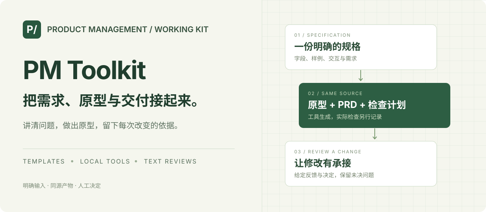
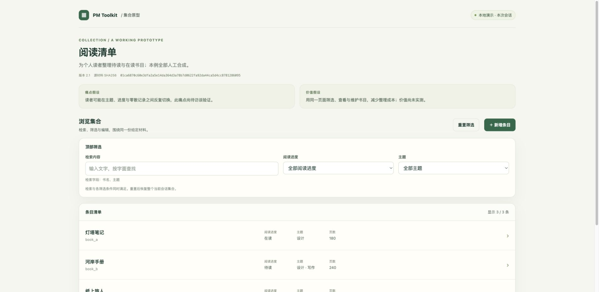
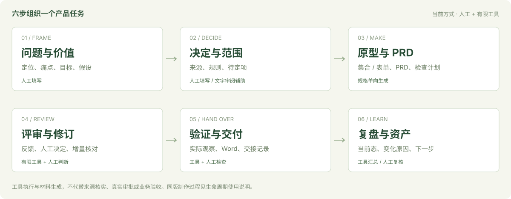

<p align="center"></p>

<p align="center"><strong>A local working kit for product managers: clarify the problem, build a prototype, hand over the same version.</strong></p>

<p align="center"><a href="README.md">简体中文</a> · English<br><a href="walkthrough.html">See the workflow</a> · <a href="start.html">Try your own task</a></p>

PM Toolkit connects a brief, scope and rules, prototype, PRD, Word document, review and delivery records to one task version. You supply evidence, make product decisions and run the checks. The tools generate matching artifacts, inspect supplied relationships and retain unresolved items.

**Local workbench · Publicly verified on 2026-10-28.** The verified runtime baseline is [d54e6586f4a173dea73155f8564aafbcfb5d9d25](https://github.com/jamieluo26/pm-toolkit/commit/d54e6586f4a173dea73155f8564aafbcfb5d9d25), with 356 files and 147 passing tests in a fresh anonymous Git copy. The browser workbench runs Python locally to create, revise and hand over matching prototype, PRD and Word files. See the [workbench guide](docs/local-workbench.md) and [verification record](docs/verification-local-workbench.md). The earlier v1.0/139-test evidence remains in the [historical record](docs/verification-v1.md).

The walkthrough explains one synthetic task from creation through revision and handoff. The guided trial helps you record your own observations. Their checks are recorded separately in [walkthrough and trial verification](docs/verification-promotion.md).

| Start here | What you get | Read on GitHub |
|---|---|---|
| [See the workflow](walkthrough.html) | Follow one synthetic task and its human decision points; no model or Python needed to read | [Text walkthrough](docs/walkthrough.md) |
| [Try your own task](start.html) | Set up the local workbench, then create, revise and hand over matching files | [Local setup and operations](docs/local-workbench.md) |

> GitHub displays HTML source. Open the complete copy's local `index.html` for interactions. [Download the complete repository ZIP](https://github.com/jamieluo26/pm-toolkit/archive/refs/heads/main.zip), extract it, and check its CHANGELOG for the version. No hosted interactive demo is provided.

## Quick start

Start with the [local workbench guide](docs/local-workbench.md). From the toolkit root:

```sh
python3 -m venv .venv
.venv/bin/python -m pip install -r requirements.txt
.venv/bin/python pm_workbench.py --workspace ../my-pm-workspace --port 8841
```

Open `http://127.0.0.1:8841` in Chrome and keep the terminal running. The server was actually verified on macOS. It requires Unix `fcntl`; Linux first use has not been verified, and Windows is unsupported for this server. Store your workspace outside the repository.

To read prepared artifacts, open `index.html` in the complete copy. HTML and prepared Word documents need no Python, account or model. The [older short demonstration](demo.html) uses three actual browser frames showing filtering, an empty result and recovery.

For the CLI alternative, regenerate a handoff for one task version from the toolkit root:

```sh
python3 -m venv .venv
.venv/bin/python -m pip install -r requirements.txt
.venv/bin/python pm_task.py build --source examples/lifecycle/before.json --output ../my-reading-task
.venv/bin/python pm_task.py check --source examples/lifecycle/before.json --output ../my-reading-task
```

Open `journey.html`, then `prototype.html`, `PRD.md` and `handoff.docx`. They correspond to one `task.json`. Word projects the complete ordered PRD content. The generated acceptance plan still needs execution.

Use a **new output directory** whose parent exists. Windows CLI first use has not been verified; the workbench server above is unsupported on Windows. See the [lifecycle guide](docs/lifecycle.md) and [local diagnostics](docs/support-tools.md).

For a lightweight collection using only the Python 3.10+ standard library:

```sh
python3 pm_flow.py build --source examples/personal-tasks/spec.json --output ../my-task-board
python3 pm_flow.py check --source examples/personal-tasks/spec.json --output ../my-task-board
```

## Advanced and retained paths

| Purpose | Entry |
|---|---|
| Follow the guided trial | [Trial materials and observation prompts](trial/README.md) |
| Browse prepared examples | [Retained examples](START-HERE.md#进阶与历史路径) or local `index.html` |
| Use the CLI | [Prepare your own task](#use-your-own-task) and [lifecycle commands](docs/lifecycle.md) |
| Use an AI Skill | [Explicit materials and Skill entries](#ai-skills) |
| Find a module or contract | [Documentation](docs/README.md) |

## Three worked scenarios

| Scenario | Entry | What to inspect |
|---|---|---|
| Complete a reading-tool iteration | [Guide](examples/lifecycle/README.md), [before](examples/lifecycle/before-output/journey.html), [after](examples/lifecycle/after-output/prototype.html) | Brief and rules through prototype/PRD/Word, filter-layout review, [delivery and retrospective](examples/lifecycle/delivery-output/delivery.md) |
| Discuss a request form | [Prototype](examples/request-flow/output/prototype.html), [specification](examples/request-flow/spec.json), [guide](docs/form-cli.md) | Required/range validation, submit, return, resubmit and read-only completion; configure and export a new specification |
| Customize a collection | [Task board](examples/personal-tasks/output/prototype.html), [specification](examples/personal-tasks/spec.json) | Fields and examples, search, intersecting filters, detail and session edits |



All cases are synthetic. The [browser summary](examples/lifecycle/browser-observations.md) supports only its listed conditions. Use evaluation is performed by an independent agent acting as a PM. Human-user feedback and real business outcomes have not been collected. The [original handoff](examples/reading-list/output/journey.html), [review package](review.html) and [collection-change example](flow.html) remain available.

## Six workpacks



| Workpack | Your contribution | Connected outputs |
|---|---|---|
| [Discover](playbooks/workpacks/01-discover.md) | Users, problem, evidence, value hypothesis and goals | Brief, decisions, success measures and unknowns |
| [Specify](playbooks/workpacks/02-specify.md) | Scope, exclusions, rules, defaults and boundaries | Requirements, rules, checks and supplied-consumer relations |
| [Prototype](playbooks/workpacks/03-prototype.md) | Review whether the interface expresses intent | Matching prototype, PRD, Word, plan and version records |
| [Review](playbooks/workpacks/04-review.md) | A decision and reason for each feedback item | Before/after changes, exact paths and unresolved items |
| [Deliver](playbooks/workpacks/05-deliver.md) | Actual observations, defects and rechecks | Current-version supplied-evidence summary and handoff |
| [Retrospect](playbooks/workpacks/06-retrospect.md) | Explain changes and assess outcomes | Version notes, requirement declarations, decision states and next questions |

Generation is one-way from an explicit task specification. Editing HTML, PRD or Word does not update it; `check` detects drift. See the [lifecycle guide](docs/lifecycle.md) and [task contract](docs/task-spec.md).

## Use your own task

Use the [local workbench](docs/local-workbench.md) to fill in your task and generate matching files from the browser. The older [task preparation page](prepare.html) prepares JSON from bounded presets; it does not generate a handoff itself and needs the CLI afterward. To create CLI inputs instead:

```sh
.venv/bin/python pm_task.py init --output ../my-task-input
```

Fill in users, pain, positioning, value hypothesis, scope, sources, rules and checks. Retain unknowns. Placeholder and pending inputs stay `HOLD`. For revisions, use `prepare-review` to prepare version references, exact change paths and pending notes. Fill in your decisions and run the second preparation step; no manual hash editing is needed. Old notes cannot move to a different version pair. After actual checks, use `deliver` for handoff, version notes and retrospective. The [lifecycle guide](docs/lifecycle.md) has commands; [maintenance](docs/maintenance.md) covers upgrades and recovery.

## Available capabilities

| Capability | How to use it | Boundary |
|---|---|---|
| Local workbench | Browser forms call actual local Python generation and checks | macOS verified; localhost only; one operator and explicit observations |
| Six workpacks | Blank materials, synthetic examples and connected steps | Source truth, trade-offs and decisions require people |
| Collection prototype | List, search, intersecting filters, empty state, detail and session edits | Bounded collections; reload restores examples |
| Request-form prototype | Text/number/choice/tags, submit/return/resubmit/complete | One local form; labels do not establish real approval |
| Same-version handoff | Prototype, PRD, Word, unexecuted plan and trace | One-way generation; content, rendering and interaction are separate checks |
| Review and delivery | Supplied feedback, decisions, observations and recheck chains | Missing, stale, conflicting or wrong-layer evidence stays `HOLD` |
| Product assets | Supplied changes, requirement declarations and decision states | Does not certify production state or establish gains |
| Text Skills | Two retained public versions; four new complete suites and six explicit calls verified | Explicit inputs; a folder does not mean installed |

Diagnostics, selected-file HTML static audits, stable-key snapshot comparison and the fixed mindmap component provide support. See the [capability map](MODULES.md) and [documentation](docs/README.md).

## AI Skills

Give your own assistant the complete `SKILL.md` and explicit materials. Outputs are cited drafts for human review.

| Skill | Input → output | Status |
|---|---|---|
| [Requirement/acceptance trace](skills/requirement-acceptance-trace-review/SKILL.md) | Requirements, checks and relations → gap/conflict draft | Retained public tree; current explicit call verified |
| [Feedback-intent preservation](skills/feedback-intent-preservation-review/SKILL.md) | Functions, carriers and decisions → preservation/unknowns draft | Retained public tree; current explicit call verified |
| [Meeting decision evidence](skills/meeting-decision-evidence/SKILL.md) | Discussion → cited decisions, disagreements and context | Full suite and explicit call verified |
| [Declared impact coverage](skills/declared-impact-coverage-review/SKILL.md) | Objects, consumers and exclusions → relationship review | Full suite and explicit call verified |
| [Supplied acceptance evidence](skills/supplied-acceptance-evidence-review/SKILL.md) | Conditions, states and observations → evidence-gap review | Full suite and explicit call verified |
| [Product asset handbook](skills/product-asset-handbook/SKILL.md) | Versions and evidence → handbook/handoff draft | Full suite and explicit call verified |

The [current Skill guide](docs/skills-v1.md) lists inputs and human decision points. Full-tree governance, actual specified-host calls and workpack combination replay are separate layers; these technical layers are complete; draft content still requires human review. The CLI does not call a model or change host settings. Your host determines account, material handling and cost.

## Documentation and help

- [Local workbench](docs/local-workbench.md): the recommended run path.
- [Text walkthrough](docs/walkthrough.md) and [trial guide](trial/README.md): workflow explanation and bounded trial materials.
- [Walkthrough and trial verification](docs/verification-promotion.md): evidence for these entries, separate from the runtime release.
- [Start here](START-HERE.md): retained example and CLI entries.
- [Documentation](docs/README.md): lifecycle, modules, contracts and verification boundaries.
- [FAQ](docs/faq.md): dependencies, directories, synchronization, `HOLD` and Skills.
- [Maintenance](docs/maintenance.md): preserve inputs, rebuild and recover.
- [CHANGELOG](CHANGELOG.md) and [ROADMAP](ROADMAP.md): version history and further scope.

## Sources and use

The fixed mindmap and Word distributions come from [Product Mindmap](https://github.com/jamieluo26/product-mindmap) and [Structured DOCX](https://github.com/jamieluo26/structured-docx). Versions are in [UPSTREAM.json](UPSTREAM.json). [Product Delivery Playbook](https://github.com/jamieluo26/product-delivery-playbook) supplies related guidance. Upstream repositories maintain the fixed components; this kit adapts task materials.

The tools retain caller-provided content and do not anonymize it. Input consistency, code execution, browser behavior, Word rendering and human acceptance need their own evidence. See [NOTICE](NOTICE.md). No new open-source license has been added.

[Current workbench verification and scope limits](docs/verification-local-workbench.md)
