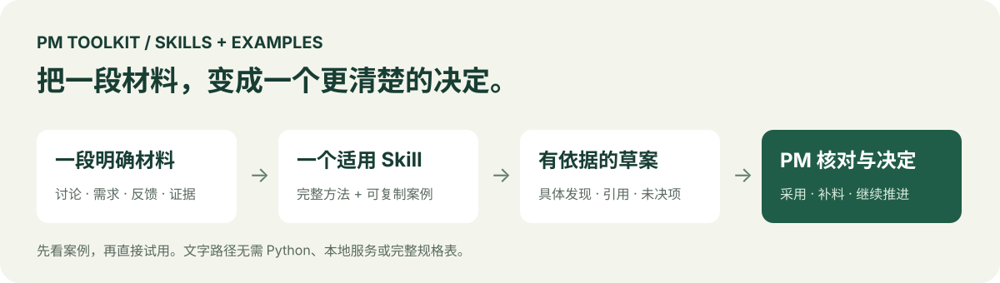

# PM Toolkit

**Six PM Skills, with complete examples you can inspect and try.**

Bring supplied discussions, requirements or feedback to your own text-capable AI assistant. Get cited review drafts and concrete questions to resolve. The text workflow does not require Python, a local server or the workbench.

[中文](README.md) · [Start with the feedback example](examples/skills/01-feedback-intent/README.md) · [Usage guide](docs/skill-quickstart.md) · [All examples](examples/skills/README.md)

| Your task / example | Skill | Minimum material |
|---|---|---|
| [Preserve function intent when a sidebar is removed](examples/skills/01-feedback-intent/README.md) | [feedback-intent-preservation-review](skills/feedback-intent-preservation-review/SKILL.md) | Given functions, carriers, feedback and decisions |
| [Separate decisions from proposals in a discussion](examples/skills/02-meeting-decisions/README.md) | [meeting-decision-evidence](skills/meeting-decision-evidence/SKILL.md) | Visible meeting excerpts and context |
| [Find omissions in declared change scope](examples/skills/03-impact-coverage/README.md) | [declared-impact-coverage-review](skills/declared-impact-coverage-review/SKILL.md) | Object identities, consumers and exclusions |
| [Connect requirements to acceptance checks](examples/skills/04-requirement-trace/README.md) | [requirement-acceptance-trace-review](skills/requirement-acceptance-trace-review/SKILL.md) | Nodes, link meanings and trace claims |
| [Review whether supplied evidence covers the criteria](examples/skills/05-acceptance-evidence/README.md) | [supplied-acceptance-evidence-review](skills/supplied-acceptance-evidence-review/SKILL.md) | Version, conditions, states and observations |
| [Turn scattered records into a maintainable handbook](examples/skills/06-product-handbook/README.md) | [product-asset-handbook](skills/product-asset-handbook/SKILL.md) | Scope, versions, rationale and evidence |

## Try one

1. Copy the full [feedback invocation](examples/skills/01-feedback-intent/prompt.md) into your own assistant. It includes the complete unchanged Skill and all line-labelled synthetic input.
2. Inspect the [unedited model output](examples/skills/01-feedback-intent/result.md) and the editorial explanation in the case README.
3. Replace the synthetic material with content you are authorized to process. Check citations, unknowns and recommendations before adopting anything.

The examples and recorded outputs are in Chinese. You may request another output language; these records do not verify a translated result. Explicit text supply is distinct from native Skill installation or automatic discovery. See the [complete Skill directories](skills/) for the unchanged packages and optional supporting material.

## What is recorded

Each case includes `input.md`, a self-contained `prompt.md`, an unedited actual `result.md`, a editorial explanation prepared with Codex, and a `run.json` binding the exact input, Skill tree and output hashes. This is one synthetic invocation per Skill, not a claim of universal quality, host compatibility, human approval or production acceptance. See [verification](docs/verification-skills-examples.md).

## Demo, stories and feedback

[Short demo and three case stories (Chinese)](outreach/README.md) explain specific findings from the synthetic cases. [Trial feedback](outreach/trial-feedback.md) asks only three core questions; submitting a GitHub Issue is public. The demo shows existing outputs, not a new live model run or human trial.

## Optional tools

Prototype, PRD, Word and local workbench tools remain [optional](docs/optional-tools.md). The [previous demo](toolkit-demo.html) and [lifecycle example](examples/lifecycle/README.md) are preserved. The primary delivery is Skills and examples.

Only supplied material is reviewed. Outputs are drafts; missing sources and unresolved decisions remain explicit. The tools retain caller content and do not anonymize it. See [NOTICE](NOTICE.md) and [UPSTREAM.json](UPSTREAM.json). No open-source license is included.
