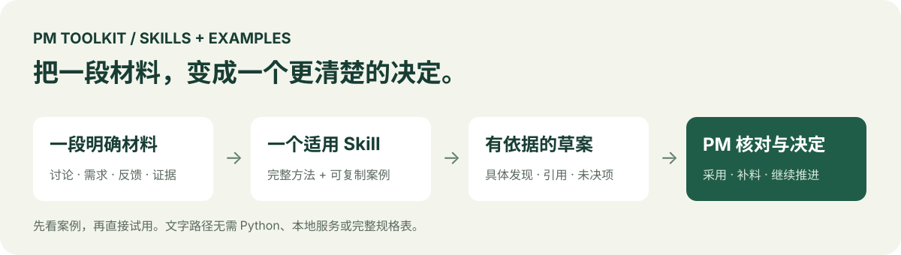

# PM Toolkit

**把讨论、需求和反馈，变成有依据的产品判断。**

六个可独立使用的PM Skills，每个都配完整合成输入、可复制调用、实际AI输出和编辑解读。选一个问题，把Skill和材料交给自己的AI助手，就能开始；文字使用路径无需Python或本地工作台。

[从一个案例开始](examples/skills/01-feedback-intent/README.md) · [怎样直接使用](docs/skill-quickstart.md) · [短演示与案例文章](outreach/README.md) · [English](README.en.md)

## 你现在遇到什么问题？

| 你的问题 / 完整案例 | 选这个Skill | 得到什么 |
|---|---|---|
| [删侧栏，会不会把功能一起删掉？](examples/skills/01-feedback-intent/README.md) | [feedback-intent-preservation-review](skills/feedback-intent-preservation-review/SKILL.md) | 功能承接、未安置意图与最少补充决定。 |
| [讨论完了，究竟哪些已经决定？](examples/skills/02-meeting-decisions/README.md) | [meeting-decision-evidence](skills/meeting-decision-evidence/SKILL.md) | 分场景的决定、演变、冲突和待补材料。 |
| [改共享组件，有没有漏掉使用它的页面？](examples/skills/03-impact-coverage/README.md) | [declared-impact-coverage-review](skills/declared-impact-coverage-review/SKILL.md) | 逐关系处理、漏项、孤立排除和未知范围。 |
| [需求和验收数量一样，为什么仍然有遗漏？](examples/skills/04-requirement-trace/README.md) | [requirement-acceptance-trace-review](skills/requirement-acceptance-trace-review/SKILL.md) | 正向路径、反向来源、断链和跨材料冲突。 |
| [报告写“检查通过”，实际证据够吗？](examples/skills/05-acceptance-evidence/README.md) | [supplied-acceptance-evidence-review](skills/supplied-acceptance-evidence-review/SKILL.md) | 逐单元证据覆盖、错位、重复、缺口和最少补证。 |
| [零散版本资料，怎样交成一份可维护手册？](examples/skills/06-product-handbook/README.md) | [product-asset-handbook](skills/product-asset-handbook/SKILL.md) | 0—8九节产品手册草案，包含证据层次及维护缺口。 |

## 先看一个有用的发现

评审反馈只有一句：**“侧栏太占地方，去掉吧。”**

原侧栏同时承担“主题筛选”和“导出结果”。新方案把筛选放到顶部，却没有说明导出怎么办。反馈意图Skill会沿给定功能与决定核对承接关系，让遗漏变成一个具体问题：**导出功能继续保留，但它的新入口在哪里？**

| 给AI的材料 | Skill形成的草案 | PM需要判断 |
|---|---|---|
| 原功能、反馈、替代方案与适用决定 | 哪项有承接，哪项缺入口，哪里缺依据 | 补替代载体，或提供适用取消依据 |

以上是编辑解读。[完整输入](examples/skills/01-feedback-intent/input.md)、[一次实际输出](examples/skills/01-feedback-intent/result.md)与[来源绑定](examples/skills/01-feedback-intent/run.json)可以逐项对照。草案没有替你修改产品。

## 怎么开始

1. 打开一个案例的**完整调用文本**，复制到自己的AI助手；其中已含完整Skill和本次全部材料。
2. 先原样试用，再把合成材料换成自己有权处理的内容。
3. 核对输出引用、未知项和建议，再决定采用什么。

**[现在试“反馈意图保留” →](examples/skills/01-feedback-intent/prompt.md)**

想独立保存Skill，可从[`skills/`](skills/)取得完整目录，保留其中引用与可选模板。宿主支持原生Skill时按其机制加载；本包已验证的是显式文字供料，不声称所有助手都能自动安装或发现。

## 每个案例都能看到什么

`input.md`合成材料 → `prompt.md`完整调用 → `result.md`未编辑的实际AI最终正文 → `README.md`编辑解读与下一步。`run.json`绑定准确输入、Skill树和输出摘要。

六项文字Skill完整沿用已有公开树。本轮新案例和教程放在树外；[验证与限制](docs/verification-skills-examples.md)区分调用成功、内容核对与真实使用。没有采集节省时间、真人满意度或业务收益数据。

## 试用后，留三条反馈

选了哪个案例、完成到哪一步、最希望改哪一点。[填写试用反馈](outreach/trial-feedback.md)，不要求提供姓名、公司或原始项目材料。GitHub Issue是公开反馈路径，也可先保存为本地文本。

## 配套工具与更多材料

需要演示原型、PRD或Word时，可按[可选工具说明](docs/optional-tools.md)使用既有本地工具；[旧版演示入口](toolkit-demo.html)、[完整迭代案例](examples/lifecycle/README.md)及历史记录保留。

[文档中心](docs/README.md) · [能力地图](MODULES.md) · [常见问题](docs/faq.md) · [版本记录](CHANGELOG.md) · [后续方向](ROADMAP.md)

## 使用边界

Skills只审阅实际提供的材料，输出需要人工核对。缺材料、引用冲突和未执行检查应继续保留；不能把草案当业务批准、生产事实或验收通过。工具保留调用者内容，本身不脱敏。

来源与使用范围见[NOTICE](NOTICE.md)。当前仓库未附开源许可证。沿用组件见[UPSTREAM.json](UPSTREAM.json)。
