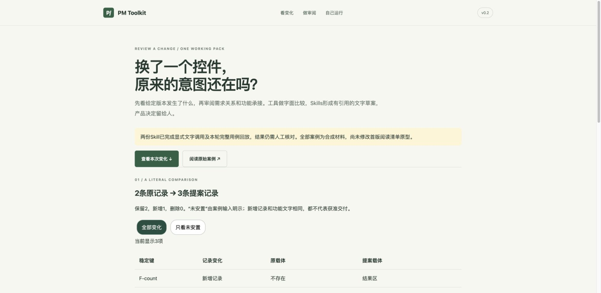
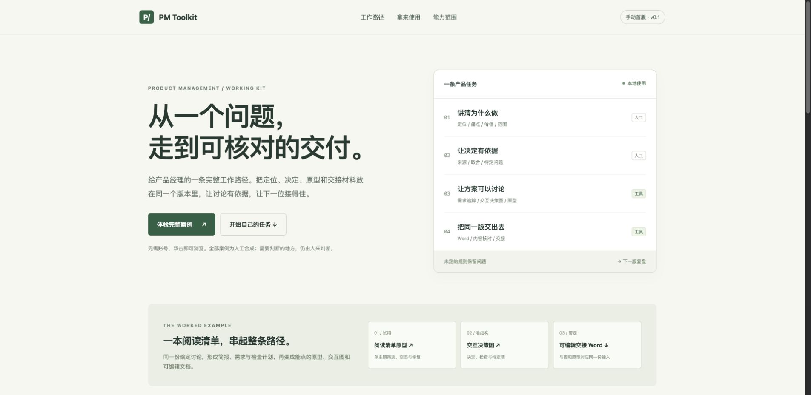

# PM Toolkit

**v0.2：评审变更工作包。** 新增稳定键双快照比较工具，以及需求/验收追踪和反馈意图保留两份文本审阅Skill。两棵当前完整树均通过5项治理用例，候选汇总门通过；使用与宿主边界见验证说明。

[体验评审变更工作包](review.html) · [步骤](playbooks/review-change.md) · [运行说明](docs/review-workpack.md) · [Skill实际边界](docs/skills-v02.md)

```sh
python3 pm_review.py demo --output ../my-review
python3 pm_review.py check --output ../my-review
```

它生成一份9文件的全合成评审目录，把字面变化、关系审阅和功能承接放在一起；不自动调用模型、修改原型或代替验收。公开的v0.1工作路径仍保留，旧命令不变。



## 已公开的v0.1工作路径

把需求、方案和交付接成一条能实际使用的工作路径。

面向产品经理和研发协作者的**手动首版 v0.1**：六份可填写模板、一条完整合成案例、交互决策图、可操作演示原型、可编辑Word，以及本地生成与核对命令。AI可以辅助审阅文字，本包不调用模型或安装Skill。



## 立即体验

下载或复制整个目录后，双击 **index.html**。首页不需要Python、账号或联网；从“体验完整案例”开始，可打开原型、导图和预制Word。

[任务导航](START-HERE.md) · [完整案例](examples/reading-list/output/journey.html) · [七模块实际状态](MODULES.md)

## 用到自己的工作里

复制templates中的表格到自己的项目，按[六步工作说明](playbooks/product-task.md)填写。需要一次创建空白材料时，运行：

```bash
python3 pm_toolkit.py init --output ../my-product-task
```

若要重新生成案例，先在自己的Python 3.10+虚拟环境安装依赖，再运行：

```bash
python3 -m venv .venv
.venv/bin/python -m pip install -r requirements.txt
.venv/bin/python pm_toolkit.py demo --output ../reading-list-demo
.venv/bin/python pm_toolkit.py check --source examples/reading-list/case.json --output ../reading-list-demo
```

Windows使用`.venv\Scripts\python.exe`替换`.venv/bin/python`。上例输出目录必须不存在且父目录已存在；不会覆盖既有项目。生成失败返回非零；若写入中断，保留INCOMPLETE.txt，不能把它当成功交付。

修改本例的书目、主题和文字后，可用`build --source path/to/case.json --output ../my-demo`生成。它仍是阅读清单演示合同，不会根据任意需求自动开发应用。完整输入与失败边界见[运行说明](docs/cli.md)。

## 已经接入什么

导图和Word代码以固定分发副本随包提供，权威源分别为已公开的[Product Mindmap](https://github.com/jamieluo26/product-mindmap)与[Structured DOCX](https://github.com/jamieluo26/structured-docx)；版本及四文件SHA见[UPSTREAM.json](UPSTREAM.json)。[Product Delivery Playbook](https://github.com/jamieluo26/product-delivery-playbook)提供相关文字工作法入口。本包不形成第二套独立修改的工具实现。

## 判断结果前

CLI只核对给定输入和输出的一致性。浏览器行为、文档排版、真实业务质量和人的验收分别记录。所有新材料与书目都是人工合成，用户价值仍是待证假设；工具处理自带材料时会保留其中内容，本身不脱敏。

[本版制作验证记录](examples/reading-list/review-record.md) · [案例当前态](examples/reading-list/product-state.md) · [验证范围](docs/verification.md) · [组件来源](NOTICE.md) · [个人使用说明](docs/personal-use.md)

本包暂不附加新的开源许可证。组件版本与分发范围见NOTICE.md和UPSTREAM.json；实际功能与验证边界见上文。
