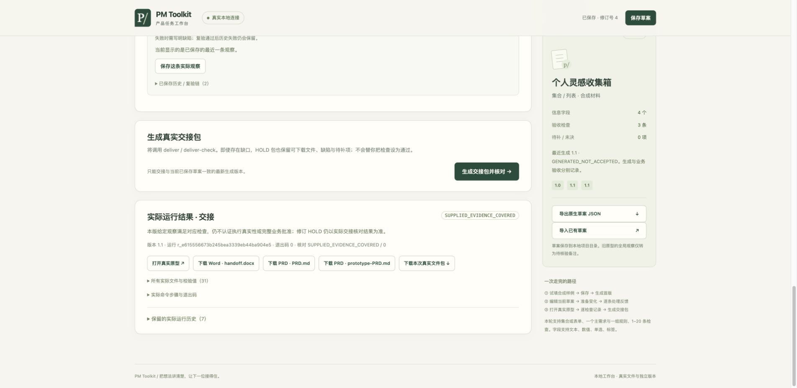

<p align="center"></p>

<p align="center"><strong>给产品经理的本地工作台：讲清问题，做出原型，把同一版交出去。</strong></p>

<p align="center">简体中文 · <a href="README.en.md">English</a><br><a href="#快速开始">快速开始</a> · <a href="#三个可以动手的场景">案例</a> · <a href="#六步完成一轮迭代">工作路径</a> · <a href="#当前可以使用什么">能力</a> · <a href="#使用-ai-skill">Skills</a> · <a href="docs/README.md">文档</a> · <a href="docs/faq.md">FAQ</a></p>

PM Toolkit 把产品简报、范围规则、原型、PRD、Word、评审和交付记录接到同一个任务版本。你提供材料、作产品决定、实际检查；工具生成对应产物，核对给定关系，把待定与冲突留在明处。

**本地工作台已公开。** 已验收运行功能基线为 [`d54e658`](https://github.com/jamieluo26/pm-toolkit/commit/d54e6586f4a173dea73155f8564aafbcfb5d9d25)（2026-10-28）。你可以在可视化界面创建任务、调用真实 Python 生成、处理修订并下载交接材料。本目录提供完整操作演示与首次试用任务，帮助你从查看案例走到实际交接。

## 从这里开始

| 你的目的 | 唯一推荐入口 | 会得到什么 |
|---|---|---|
| **先看完整过程** | [完整操作演示](walkthrough.html) · [文字版](docs/walkthrough.md) | 一个合成任务从创建、修订、实际观察到交接与恢复 |
| **开始自己的任务** | [本地启动页](start.html) · [启动说明](docs/local-workbench.md) | 在浏览器操作，由本机 Python 生成原型、PRD、Word 和交接包 |

GitHub 的 HTML 链接会显示源码。请[下载完整仓库 ZIP](https://github.com/jamieluo26/pm-toolkit/archive/refs/heads/main.zip)并解压，再打开 `index.html`。当前没有在线托管演示。

[](assets/walkthrough/pm-toolkit-walkthrough.mp4)

[观看／下载90秒带字幕回放](assets/walkthrough/pm-toolkit-walkthrough.mp4) · 由实际操作截图组成，非连续录屏；[完整文字步骤](docs/walkthrough.md)可直接阅读。

## 快速开始

**实际验证环境为 macOS + Chrome。** 本地服务器要求 Python 3.10+ 和 `fcntl`，Windows 当前不支持此服务器入口；Linux 首次使用与其他浏览器尚未验收。

在工具包根目录的终端运行：

```sh
python3 -m venv .venv
.venv/bin/python -m pip install -r requirements.txt
.venv/bin/python pm_workbench.py --workspace ../my-pm-workspace --port 8841
```

在 Chrome 打开终端给出的 `http://127.0.0.1:8841`，保持终端运行。工作目录放在源码外；同一工作目录只能由一个服务写入。界面依次完成 **创建任务 → 修订 → 交接**，未确认和未检查的内容保留待办。

**第一次建议使用[PM 试用任务](trial/README.md)**：导入全新合成材料，改一次筛选位置，实际操作原型，再生成交接包。试用卡与反馈表供自愿试用；当前没有真人试用结果。

只想离线查看结果时，打开 `index.html` 中的预制案例，不需要 Python。已有 CLI 和 Skill 入口保留在[进阶路径](START-HERE.md#进阶与历史路径)，不影响原有命令。

## 三个可以动手的场景

| 场景 | 从哪里开始 | 看什么 |
|---|---|---|
| **完成一次阅读工具迭代** | [完整案例](examples/lifecycle/README.md) · [前版入口](examples/lifecycle/before-output/journey.html) · [后版原型](examples/lifecycle/after-output/prototype.html) | 从简报和规则走到原型/PRD/Word，处理筛选移位反馈，再看[交付与复盘](examples/lifecycle/delivery-output/delivery.md) |
| **讨论一张请求表单** | [表单原型](examples/request-flow/output/prototype.html) · [规格](examples/request-flow/spec.json) · [操作说明](docs/form-cli.md) | 必填与数值校验、提交、退回补充、重提和只读终态；配置字段并导出新规格 |
| **换成自己的任务集合** | [个人任务板](examples/personal-tasks/output/prototype.html) · [规格](examples/personal-tasks/spec.json) | 字段和样例定制，搜索、交集筛选、详情、当前会话新增/编辑 |


案例均为人工合成。[浏览器观察摘要](examples/lifecycle/browser-observations.md)只支持其中列出的条件；使用评测采用独立代理 PM 实际操作；真人反馈与真实业务效果未采集。旧版[手动交接](examples/reading-list/output/journey.html)、[评审工作包](review.html)和[集合增量示例](flow.html)继续保留。

## 六步完成一轮迭代


| 工作包 | 你负责提供或判断 | 工具与材料接住什么 |
|---|---|---|
| [需求澄清](playbooks/workpacks/01-discover.md) | 用户、问题、证据、价值假设和目标 | 简报、决定依据、成功指标与待定项 |
| [范围与规格](playbooks/workpacks/02-specify.md) | 纳入/排除、规则、默认与边界 | 需求、规则、检查和给定消费者的引用关系 |
| [原型与 PRD](playbooks/workpacks/03-prototype.md) | 核对界面表达是否符合意图 | 同源原型、PRD、Word、检查计划与版本记录 |
| [评审修订](playbooks/workpacks/04-review.md) | 每条反馈的处理决定与理由 | 前后差异、准确变更路径和未决问题 |
| [验证交付](playbooks/workpacks/05-deliver.md) | 实际操作、观察、问题及复验 | 当前版本的给定检查汇总、交接与文件清单 |
| [复盘资产](playbooks/workpacks/06-retrospect.md) | 解释变化、核对真实结果 | 版本说明、需求声明、决定状态与下一轮问题 |

同源生成从明确的任务规格到产物。直接改 HTML、PRD 或 Word 不会回灌源文件；`check` 会识别漂移。[完整步骤](docs/lifecycle.md)与[任务输入合同](docs/task-spec.md)说明怎样修改、修订和交付。

## 用于自己的项目

推荐先按[本地启动说明](docs/local-workbench.md)进入可视化工作台，填写、保存并生成自己的任务。偏好 CLI 时仍可使用[任务准备页面](prepare.html)导出材料，再运行生成命令。也可以创建一份带待定项的空白任务：

```sh
.venv/bin/python pm_task.py init --output ../my-task-input
```

填写用户、痛点、定位、价值假设、范围、来源、规则和检查，保留尚未确认的内容。任务版与原型版的关系受[输入合同](docs/task-spec.md)约束；占位或待定材料会保留 `HOLD`。

修订时保留前版文件，用 `prepare-review` 自动准备版本引用、准确差异路径和待定反馈草案；填写自己的处理决定后再生成核对结果，无需手填哈希。实际检查后填写观察记录，用 `deliver` 形成交接、版本说明和复盘。[自定义修订步骤](docs/lifecycle.md#修订自己的任务无需手填哈希)提供完整命令；[维护说明](docs/maintenance.md)解释升级与恢复。

## 当前可以使用什么

| 能力 | 使用方式 | 支持边界 |
|---|---|---|
| 六个产品工作包 | 空白材料、已填合成例、连续操作说明 | 来源真实性、需求取舍和业务决定由人核对 |
| 集合原型 | 列表、搜索、交集筛选、空态、详情及会话编辑 | 有限集合；刷新恢复样例 |
| 表单状态原型 | 文本/数值/单选/标签，提交、退回、重提、完成 | 本地单表单，状态标签不代表真实审批 |
| 同源交接 | 同任务生成原型、PRD、Word、待执行计划与追踪 | 单向生成；内容核对与排版/实际交互分别验收 |
| 评审与交付 | 给定反馈、决定、观察、失败/复验的关系核对 | 未决、错层、过期或缺失保持 `HOLD`；引用由调用者提供 |
| 产品资产 | 汇总给定版本变化、需求声明、决定状态和下一轮问题 | 不认证生产当前态，不推导真实收益 |
| 文字 Skills | 两项沿用公开版本，四项新增树完整治理与六次显式调用已通过 | 显式供料；目录存在不等于已安装 |

本地环境诊断、给定 HTML 静态审计、稳定键快照比较及固定导图组件是配套工具，见[能力地图](MODULES.md)和[文档中心](docs/README.md)。

## 使用 AI Skill

先选任务，再向自己的助手提供完整 `SKILL.md` 与准确材料。结果是带引用的文字草案，需要人工核对。

| Skill | 输入与输出 | 当前状态 |
|---|---|---|
| [需求与验收追踪](skills/requirement-acceptance-trace-review/SKILL.md) | 给定需求、检查和关系 → 缺口/冲突草案 | 沿用公开树；本轮显式调用已验证 |
| [反馈意图保留](skills/feedback-intent-preservation-review/SKILL.md) | 给定功能、载体和决定 → 承接/未决项草案 | 沿用公开树；本轮显式调用已验证 |
| [会议决定证据](skills/meeting-decision-evidence/SKILL.md) | 给定讨论 → 有引用的决定、分歧及上下文 | 完整治理及显式调用已验证 |
| [给定影响范围](skills/declared-impact-coverage-review/SKILL.md) | 对象、消费者与排除理由 → 关系审阅 | 完整治理及显式调用已验证 |
| [给定验收证据](skills/supplied-acceptance-evidence-review/SKILL.md) | 条件、状态、观察 → 证据缺口审阅 | 完整治理及显式调用已验证 |
| [产品资产手册](skills/product-asset-handbook/SKILL.md) | 给定版本与证据 → 手册及交接草案 | 完整治理及显式调用已验证 |

[当前调用说明](docs/skills-v1.md)列出材料和人工停点。完整树治理、指定宿主实际调用、组合工作包回放分别记录；本轮技术层已闭合，草案仍需人工核对。CLI 本身不调用模型或修改宿主配置。使用自己的助手时，账号、材料处理与费用由该宿主决定。

本次入口、演示与试用包的实际条件见[本地验证](docs/verification-promotion.md)。

## 文档与常见问题

- [任务导航](START-HERE.md)：从当前问题选择入口。
- [产品定位](docs/product-positioning.md)：目标用户、优先任务与待验证的价值。
- [支持范围](docs/support-scope.md)：已公开本地工作台的能力、环境和证据边界。
- [文档中心](docs/README.md)：完整任务、独立模块、规格与验证边界。
- [FAQ](docs/faq.md)：运行失败、输出目录、同步、`HOLD` 和 Skill 调用。
- [维护与升级](docs/maintenance.md)：保留输入、重建新目录、检查版本与恢复。
- [CHANGELOG](CHANGELOG.md)与[ROADMAP](ROADMAP.md)：v1.0 已发布范围、历史版本与后续独立范围。

## 来源与使用说明

导图与 Word 的固定分发副本分别来自 [Product Mindmap](https://github.com/jamieluo26/product-mindmap) 和 [Structured DOCX](https://github.com/jamieluo26/structured-docx)，准确版本见 [UPSTREAM.json](UPSTREAM.json)。[Product Delivery Playbook](https://github.com/jamieluo26/product-delivery-playbook)提供相关文字工作法。固定副本由原组件仓库维护，本包适配同任务材料。

工具保留调用者内容，本身不脱敏。输入一致性、代码运行、浏览器行为、Word 排版和人的业务验收各自需要证据。来源与使用范围见 [NOTICE](NOTICE.md)；当前未附加新的开源许可证。

[当前验证与适用边界](docs/verification-v1.md)
