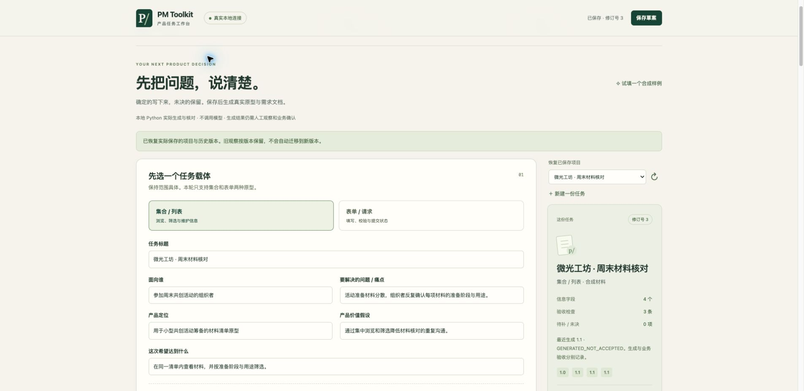
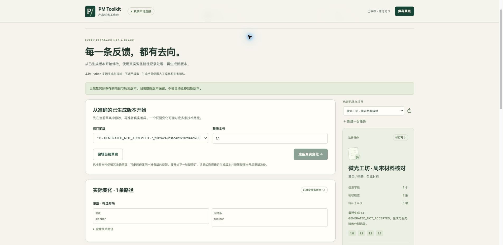
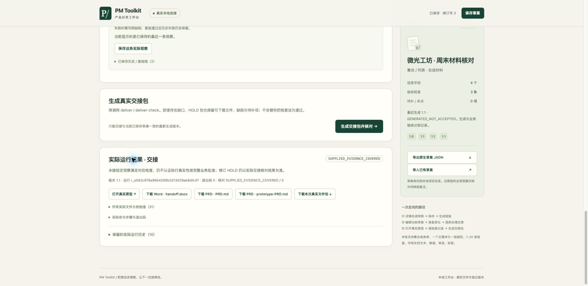

# 本地工作台候选验证记录

2026-10-28。这是尚未公开的本地运行候选的技术与代理操作记录。公开基线为 `92919fbe` 的 344 文件。本轮保留 Python 核心、固定组件、六项 Skill 和旧交互原型内容；新增界面通过固定命令适配实际核心。

## 实际覆盖

| 层次 | 本轮验证 | 支持的结论 |
|---|---|---|
| 后端 | 8 项新增回归：真实列表/表单生成、准确差异与父版本、待决/采纳、旧版隔离、失败/复验、交接、CAS、锁、超时、下载与来源保护 | 给定合同和负向条件按预期处理 |
| 原回归 | 原 139 项与新增 8 项组成 147 项，在明确真实临时目录运行通过；冻结后独立副本另做同套回归 | 既有行为在该运行条件下无测试回退 |
| Chrome 列表任务 | 显式合成输入→保存→实际生成→准确布局差异→待决 HOLD→刷新恢复反馈→采纳覆盖→逐项观察→实际交接 | 此合成任务能从界面走完实际链路 |
| Chrome 表单任务 | 两字段的新合成任务保留初值 0，-1 提交提示超界，0 提交进入只读已提交态；随后保存观察与交接 | 给定初值和数值边界可经本地工作台使用 |
| 观察记录 | 故意保留筛选前置状态的负向执行记录为失败，随后按原条件复验；两条均保留，复验引用前条 | 失败不会被覆盖；此负向执行不认定原型存在缺陷 |
| 保存与导入 | 已保存项目及同准备版反馈刷新恢复；原生草案实际导出/回导；date 导入被拒绝且当前项目保留；旧全局观察只作未验证备注 | 已记录条件下恢复有效，未把旧观察提升为通过 |
| 下载 | 浏览器实际下载 Word 和 ZIP；交接包 31 文件与运行目录逐字节一致 | 真实制品可带走，界面状态不是模拟下载 |
| Word | 浏览器下载的前后版各 6 页，全部渲染并逐页检查；中文可读，沿用完整有序 PRD 投影 | 指定字体环境下可阅读；表格/代码保持字面内容与基础分页 |
| 显示 | 桌面实际操作；390×844 目标窄屏下无页面级横向溢出；最终控制台未见错误或警告 | 只支持这些页面与视口，不扩展为全部移动设备兼容 |

## 保留的失败与修复

1. 首轮全套测试在 macOS 默认临时路径出现 33 个失败，原因是原核心拒绝 `/var` 符号链接路径。保留原结果后，用明确的真实临时目录重跑 147 项通过；未放宽核心路径保护。
2. Chrome 从外部首次打开首页曾被来源守卫误拦。修复只允许四个固定静态入口正常导航；API 与制品跨站读取、写入令牌和同源限制保持，并有回归覆盖。
3. 待决修订生成候选后，界面曾误把未变化的准备材料标为过期。修复后按相同输入复测待决→刷新恢复→显式采纳，同一前后版可以继续补处理决定；旧 HOLD 运行保留。
4. 最终复核发现旧材料的长观察/反馈会被截短且逐字段待定标记遗漏。修复改为明确保留字段待定、按顺序分片完整保存长备注，超过总容量则整次拒绝导入并保留当前材料；复测覆盖长文本完整性。
5. 原生 JSON 的 Blob 下载未触发浏览器自动化的下载事件返回；实际文件存在、内容与保存草案一致，并成功回导。事件接口未据此记为通过。

## 准确界面

材料均为人工合成；观察由代理实际操作后填写，不代表真人 PM 反馈。

## 未覆盖与保留边界

当前服务器使用 `fcntl`，仅限本机 macOS/Unix 入口；Windows、Linux 安装首用、其他浏览器、多人并发、磁盘满/断电恢复、真人易用性与真实业务收益未验收。工作台不认证所填来源、决定或观察。Word 使用已有系统中文字体的隔离渲染环境，不能证明其他阅读器和字体环境正确。

本地测试不授予公开来源资格或发布操作授权。新增文件、文案和合成截图按冻结清单集中确认；没有新增许可证、在线托管、Release 附件或私有材料。
