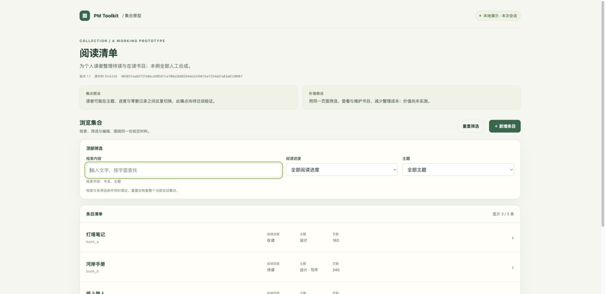
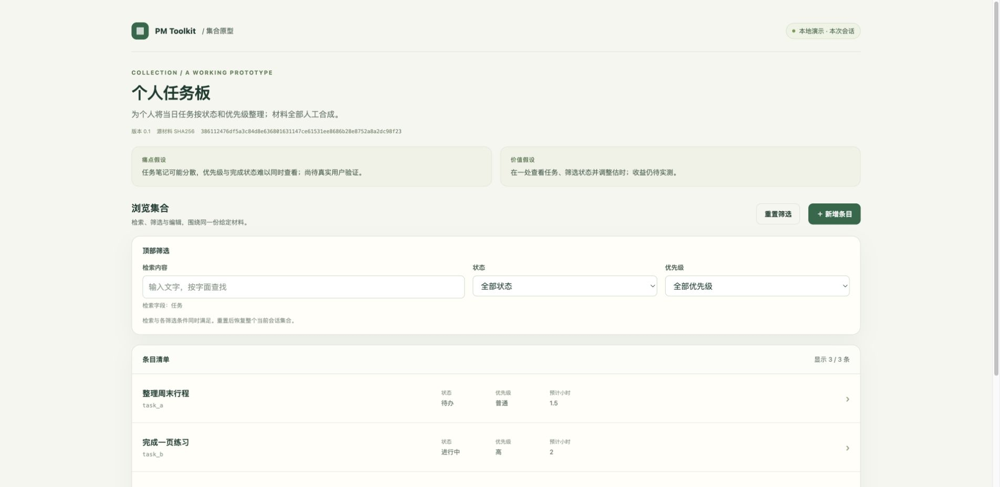

# v0.3 本地验证记录

日期：2026-10-26。范围：有限集合生成器、同源PRD/检查计划、给定反馈与决定的增量核对。新增准确公开资格已确认。本文件记录制作阶段的本地验证，不代表真实业务或人的验收；远端发布状态以实际仓库为准。

## 实际通过的层次

|层次|本轮结果|边界|
|---|---|---|
|新CLI行为|24方法、85次真实CLI调用，0失败/错误/跳过|覆盖两个不同集合、严格输入、新目录、HOLD、陈旧SHA、冲突、篡改、数值边界与来源表述|
|既有回归|v0.1的29方法、v0.2的23方法均通过|保持旧代码与测试字节，不把旧案例扩展成新能力证明|
|制品一致性|三组各6文件重新生成/check通过；review六文件重算通过|按当前源和生成器逐字节核对；trace仍为NOT_EXECUTED|
|未决反例|给定pending决定返回3/HOLD，review-check保持同一结果|没有自动替调用者批准或取消云同步|
|真实浏览器|当前授权Chrome，桌面1920×936；前后阅读清单与个人任务板实际操作及视觉检查|未证明移动端、其他浏览器、file://或复杂业务|
|Skill治理|两棵当前完整树各5项全套回放通过，独立候选总门2已验证/0未验证|不是自动安装、发现或全宿主兼容证明|
|实际显式调用|两次真实App CLI文字调用均返回，零工具事件，供料与树SHA前后稳定|仅六份显式文本；返回支持的部分草案，不是系统验收|

合计76个测试方法通过，分别来自三个有限测试集；它们不是76项真实业务验收。

## 浏览器观察

阅读清单后版实际操作了字面检索、进度×主题组合、重复筛选、空态、重置、详情、必填纯空白错误、新增与编辑；刷新恢复3条初始记录。前版侧栏也核对了空态、重置和组合筛选，后版更换顶部承载后保留这些能力。

个人任务板核对了优先级与状态组合空态、检索、详情、数值错误、有效编辑与刷新恢复。复核发现并修正的反例另行实测：初始选填单选为空时仍能编辑其他字段；已选选填单选可清空；超出9007199254740991的数值阻止保存。最终三份页面所示版本/源SHA与当前输入完全一致，当前控制台未见warning/error。

原始Markdown通过本地HTTP直接导航时被Chrome扩展以ERR_BLOCKED_BY_CLIENT阻止。未绕过；本包将相关入口标为Markdown下载，在编辑器或GitHub阅读。文档内容和同源字节已核对，不把这次阻断描述为浏览器文档展示通过，也未声称实际下载保存成功。

## 失败与修复保留

独立审读找出三项本地缺陷，已修正并补反例：可选choice空值不能保存；Python允许的超安全整数在JS舍入；通用制品错误地把任意输入标成“全合成”。现在前后端使用共同安全数值上界，选填单选可为空，生成制品如实说明调用者资料来源及脱敏未由工具核验。仓库两份样例确为本轮人工合成，这一事实仅在已知样例说明中保留。

旧23项首次回归因macOS默认临时目录的/var软链别名而失败；用实体临时目录复现了路径因果，随后仅调整测试环境重跑通过，没有放宽旧工具的链接校验。

反馈Skill原树两次完整回放分别遗漏给定记录编号，未用局部通过替代。1.0.1仅补强通用记录编号引用要求；原用例与judge保持字节，修改后当前完整树5/5通过。需求追踪Skill保持原树，复制到新候选后也重新完整回放5/5。所有失败原件保留在本地控制目录，不随包分发。

两次最终显式调用只注入两份PRD、feedback、decisions、review和trace；没有注入实际规格或页面。因此草案准确保留“未见权威规格/真实原型”及额外映射的未知项。CLI生成一致性、人工浏览器观察和文字Skill的证据范围分别成立，不能用其中一层替代其他层。实际工作中若需要核查权威源或完整检查级追踪，必须另行供料并判断，不能把缺失信息解释为空集。

## 仍未声称完成

完整通用应用开发、任意HTML/PRD双向合并、生产源码或Figma同步、持久化、多用户、真实业务验收与全套私有资产公开均不在本轮。价值表述仍为假设。工具保留调用者内容，本身不脱敏；没有新增许可证、Pages、云平台操作或全局Skill安装。
