# 完整操作演示 个人灵感收集箱

2026-10-28。画面来自本地Python工作台在Chrome中的实际操作，材料均为全新人工合成。执行者为代理；不是独立真人PM试用、真实审批或业务效果。14帧与字幕组成约90秒回放，非连续录屏，播放时长不代表操作耗时。

[本地演示页面](../walkthrough.html) · [启动工作台](local-workbench.md) · [实际试用卡](../trial/TASK-CARD.md)

## 按同一任务走完整轮

### 1. 创建任务

导入个人灵感收集箱，核对合成来源；仅为本次练习明确采用方案，然后保存。

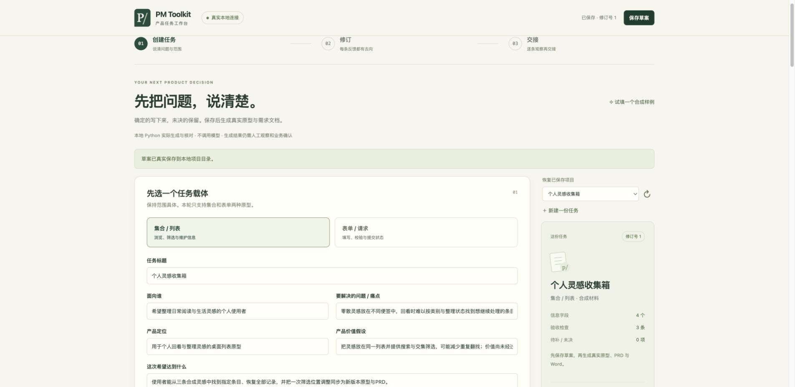

### 2. 真实生成同版材料

Python实际生成原型、PRD和Word。文件一致通过，实际操作仍待执行。

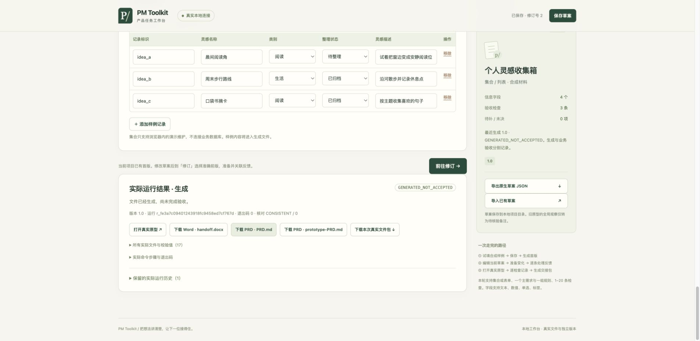

### 3. 先看首版

首版1.0显示侧栏筛选与三条合成灵感。原型在当前页面会话中操作。

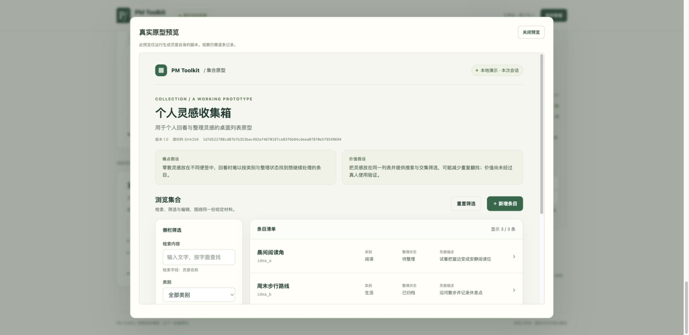

### 4. 准备一次修订

把布局改为顶部工具栏，保存后准备1.0→1.1；填写反馈原意、来源和理由。

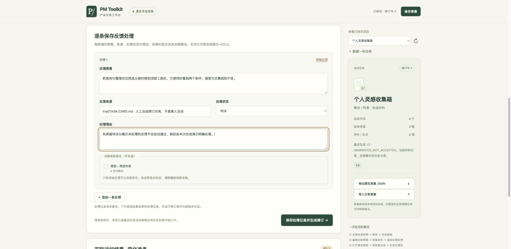

### 5. 待决会保留HOLD

先提交待决反馈，结果保留未决和布局覆盖缺口；不会自动当作已采纳。

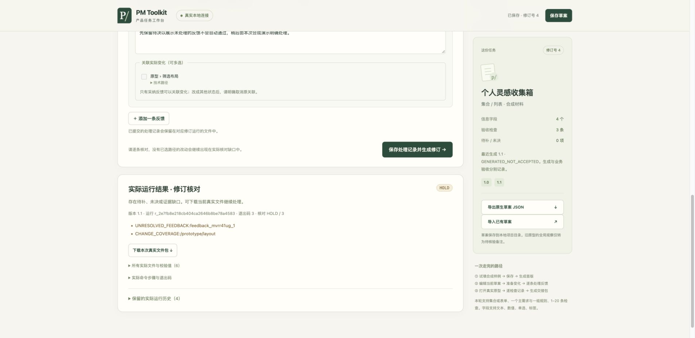

### 6. 明确处理准确变化

再明确采纳并关联实际布局路径，修订核对通过；旧待决运行继续保留。

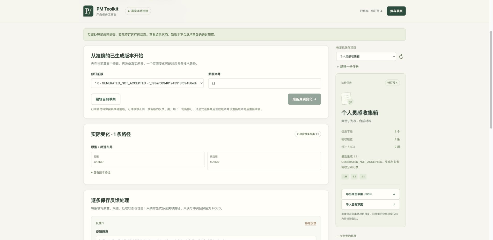

### 7. 核对新版原型与PRD

新版1.1为顶部筛选，默认3/3；实际下载PRD同样写明toolbar。

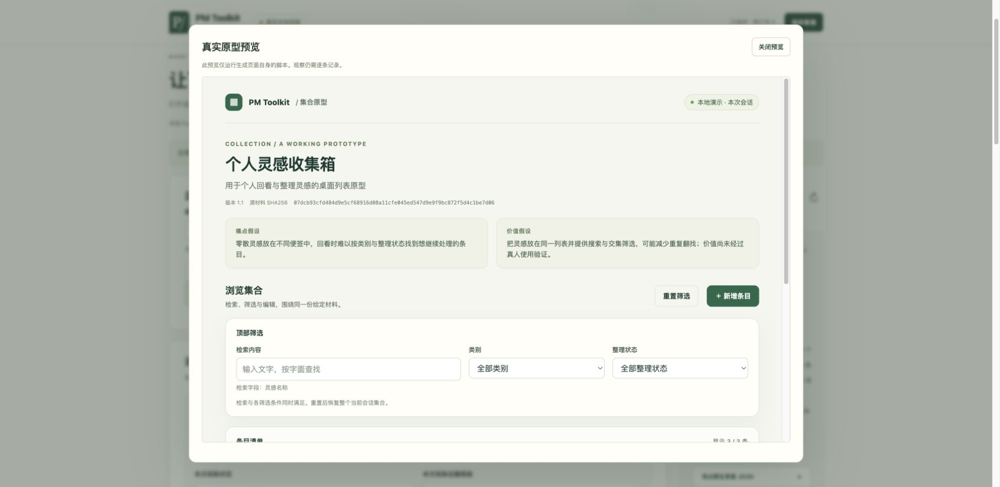

### 8. 实际执行关键词检查

在真实原型中搜索晨间，只显示晨间阅读角，计数1/3。

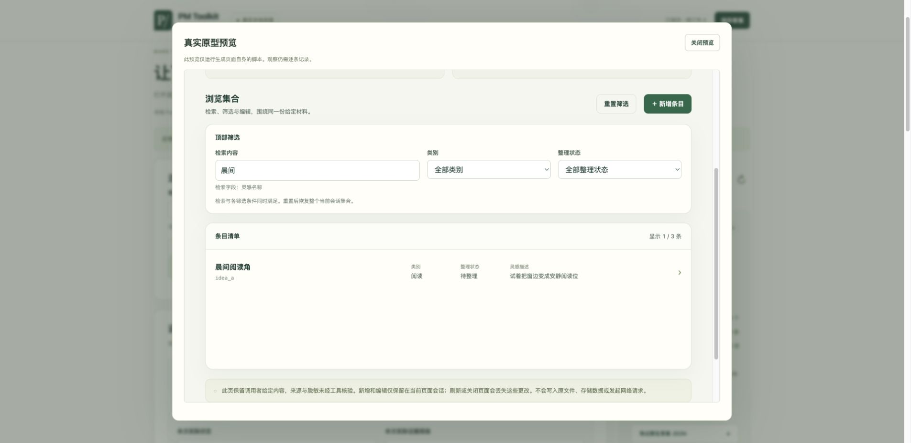

### 9. 实际执行交集检查

清空搜索，类别阅读＋整理状态已归档，只显示口袋书摘卡1/3。

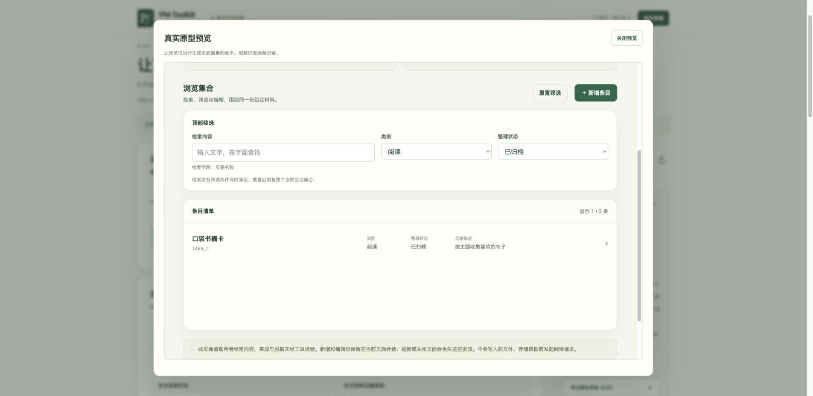

### 10. 实际执行空结果检查

重置后搜索月面花园，显示0/3和恢复全部入口。

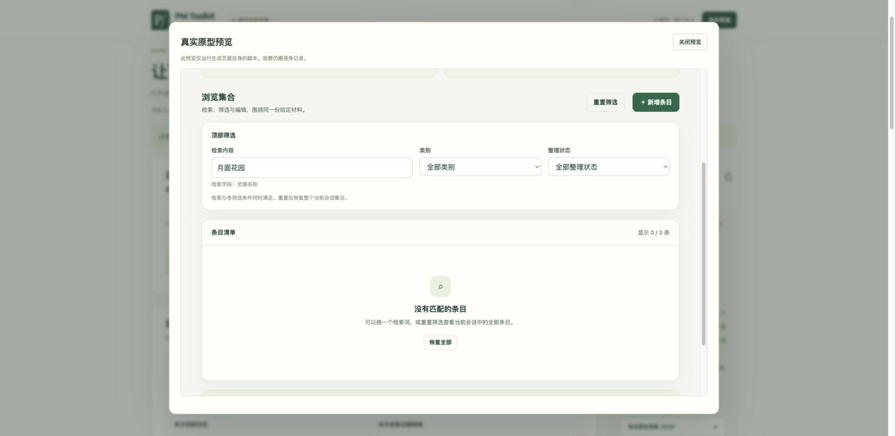

### 11. 恢复全部并看详情

恢复后3/3；周末步行路线详情的类别、状态与描述均与合成输入一致。

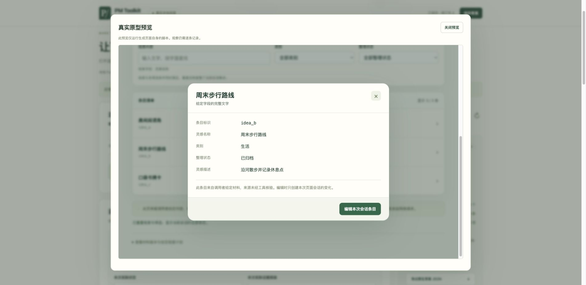

### 12. 逐条保存实际观察

代理执行完才记录三项浏览器观察与截图引用。已填记录不等于真人或业务批准。

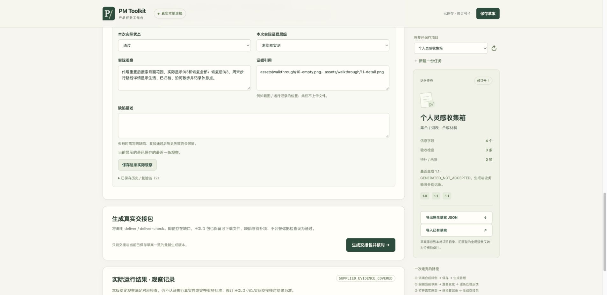

### 13. 生成并下载交接

实际deliver与deliver-check完成，31份下载文件与运行目录逐字节相同。

### 14. 重启后恢复项目

停止并重启相同工作目录，恢复项目和1.1三条已存观察；历史版本仍在。

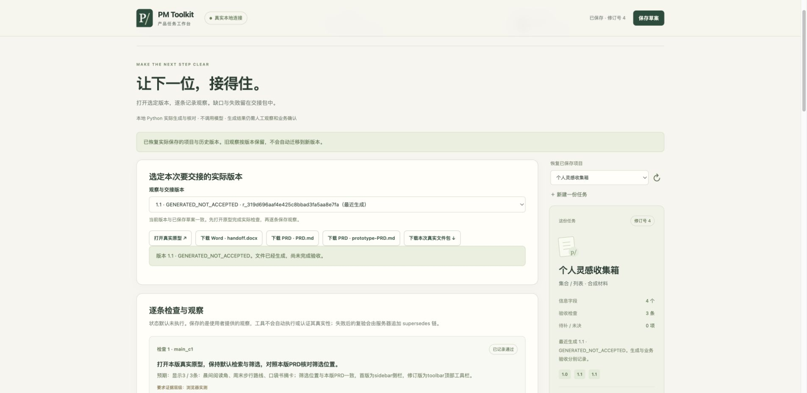

## 实际输入与文件

试用输入采用 [TASK-INPUT.json](../trial/TASK-INPUT.json) 的原生草案格式。默认是提议，未预填观察。演示中代理仅为合成练习明确采用该方案；首版1.0为sidebar，仅修改`/prototype/layout`为toolbar，修订版1.1。待决修订运行的HOLD保留，再提交明确采纳与路径关联，未覆盖旧记录。

[完整交接页面](../trial/demo-output/journey.html)、[实际原型](../trial/demo-output/prototype.html)、[PRD](../trial/demo-output/PRD.md)、[Word](../trial/demo-output/handoff.docx)及其余31份制品来自同一次实际下载包，原字节保存。PRD与Word来自同一任务源；文档核对通过与排版、业务验收分开。

本次三项浏览器条件分别覆盖默认3/3与PRD布局、关键词/交集1/3、空结果0/3→恢复3/3→详情。下载包与运行目录逐字节一致，重启服务后恢复项目和三条观察。最终交接状态为SUPPLIED_EVIDENCE_COVERED，表示给定观察覆盖，不证明真人审批。

## Word阅读条件

默认打包渲染环境缺少中文字体时出现缺字，失败记录保留。用本机已有系统中文字体隔离渲染后，正文可读；Word仍为基础有序PRD投影，字面Markdown表格与代码保留，末页有稀疏的代码结束标记。这里不将其宣传为精排报告，也不证明其他字体、阅读器或电脑的效果。

## 自己试一次

按[首批试用说明](../trial/README.md)启动本机服务并导入输入。需要macOS已验收环境、Python3.10+及Word依赖；Windows不支持本服务器，Linux首用未验。自己的任务从未执行开始，不能复制本演示的通过观察。工作目录放在源码外，备份且单进程写入。
