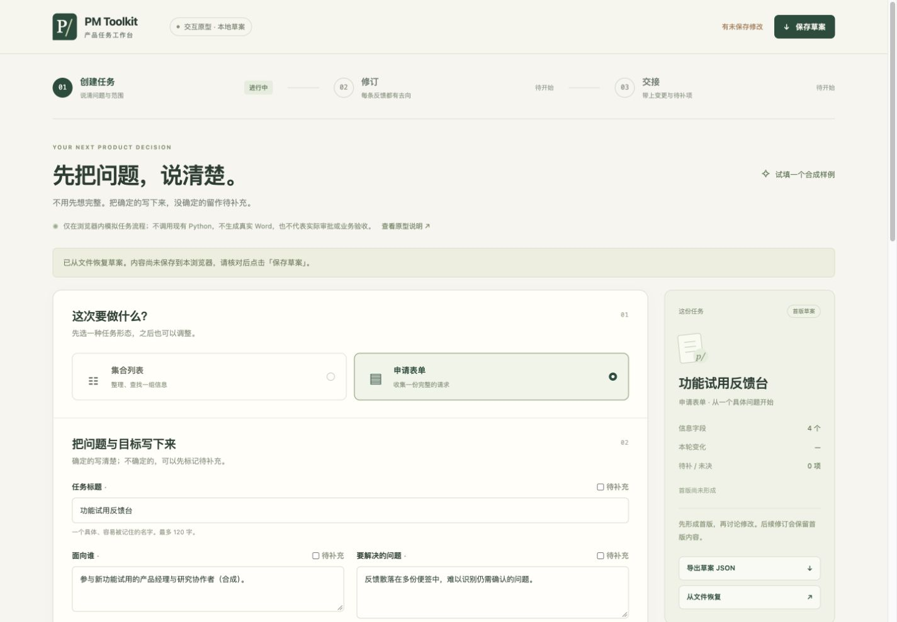
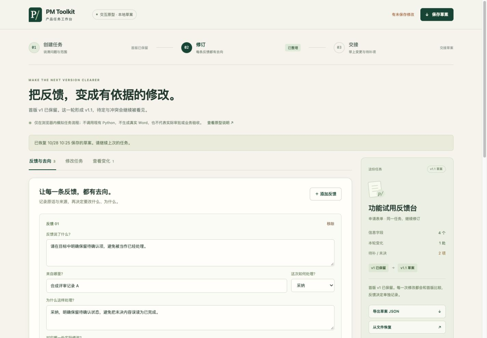
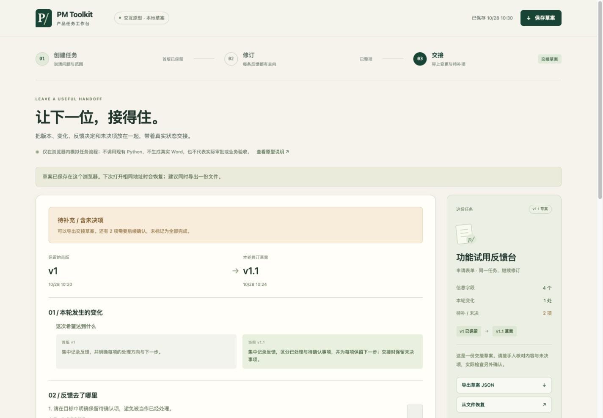

# 工作台操作原型：创建任务 → 修订 → 交接

推荐使用[本地运行工作台](local-workbench.md)：该真实 Python 接线已于 2026-10-28 随 [`d54e6586`](https://github.com/jamieluo26/pm-toolkit/commit/d54e6586f4a173dea73155f8564aafbcfb5d9d25) 公开并远端验收，356 文件、147 项回归通过。本页保留已公开的旧交互原型及其历史验证边界。

这是公众易用版的操作路径原型。它使用浏览器草案验证界面表达和状态流转，不调用 v1.0 Python 工具，不生成 DOCX，不执行或证明真实业务验收。

[打开旧交互原型](../prototypes/workbench/index.html)。使用本地副本时保留该目录的 HTML、CSS 和 JavaScript 文件。没有额外依赖、账号、远端服务、外部字体或模型调用。

## 走一遍自己的任务

1. **创建任务。** 从空白开始，或明确选择载入人工合成样例。填写标题、目标用户、问题和目标，选择集合或表单，按需要修改范围与字段。内容尚未确定时保留待补充，不为获得完成状态填写虚假决定。
2. **保存首版。** 检查最小必要内容，保存首版快照。首版用于之后的版本对照；修订不会覆盖该快照。
3. **记录反馈并修订。** 为每条意见填写原意、来源、处理方式和理由，修改本轮内容。采纳需要实际变化和理由；不采纳需要理由；待定与冲突继续显示为未决。
4. **准备交接。** 核对首版与修订、变化、反馈去向、未决项和实际观察。检查默认尚未执行，填写观察本身不构成工具认证。可以带着未决项导出交接草案，状态继续保留待补充。
5. **带走草案。** 导出原型草案 JSON 以供恢复，或导出 Markdown 交接草案供阅读。它们带有原型与未实际运行标记，不是 `pm_task.py` 输入合同或真实 DOCX 交付包。

如需实际生成原型、PRD、Word 和给定关系核对，请使用[本地运行工作台](local-workbench.md)；CLI 用户可查[生命周期步骤](lifecycle.md)。此旧原型只保留浏览器草案路径。

## 同一合成任务的三阶段界面

以下页面来自本原型的实际 Chrome 操作，材料为人工合成的“功能试用反馈台”。创建视图从该任务的原型草案文件恢复；修订与交接保留同一首版及反馈记录。这些截图展示操作设计，不代表已生成业务系统。

## 保存与恢复

显式保存使用当前浏览器、当前来源地址的本地存储，页面会说明保存成功或失败。未保存的编辑在刷新或退出前应先保存或导出。浏览器清理数据、换设备或换来源地址可能使本地草案不可用；跨设备备份使用导出的 JSON 文件。

导入只接受本原型的准确格式与支持版本。无效或不完整文件应提示原因并保留当前材料。清除本地保存、重置或切换可能覆盖输入的起点时，先确认再替换。只将有权处理的材料放入浏览器；草案本身不脱敏。

## 如何理解状态

| 页面结果 | 表示什么 |
|---|---|
| 创建了首版 | 原型保存了一份浏览器任务快照 |
| 有修订差异 | 原型比较了给定首版和当前修订草案 |
| 反馈已填写处理 | 使用者提供了处理方式与理由，不认证真实批准 |
| 尚未检查／发现问题／待补充 | 相应问题和缺口需要继续处理 |
| 已记录观察 | 使用者填写了观察，不是自动执行结果 |
| 导出交接草案 | 当前材料已输出为可读草案，不代表正式交付或业务验收完成 |

任何待定、冲突、缺观察或实际问题都应在交接中可见。修订材料变化后，旧观察不能冒充对新内容的检查。

## 旧原型历史验收范围

本原型单独验证创建、修订、未决交接、保存恢复、导入失败保留和实际导出。桌面及窄屏检查只覆盖所记录的 Chrome 视图；它们不代表其他浏览器、Windows、完整移动端或真实 PM 首次使用验收。历史 v1.0 的 139 项测试与 7 条固定检查是当时的基线证据，不替代旧原型的实际浏览器检查，也不代表当前工作台的远端验收。当前证据见[工作台验证记录](verification-local-workbench.md)。

界面定位与产品取舍见 [产品定位](product-positioning.md)，环境和能力边界见 [支持范围](support-scope.md)。真人反馈及真实业务效果仍未采集。
