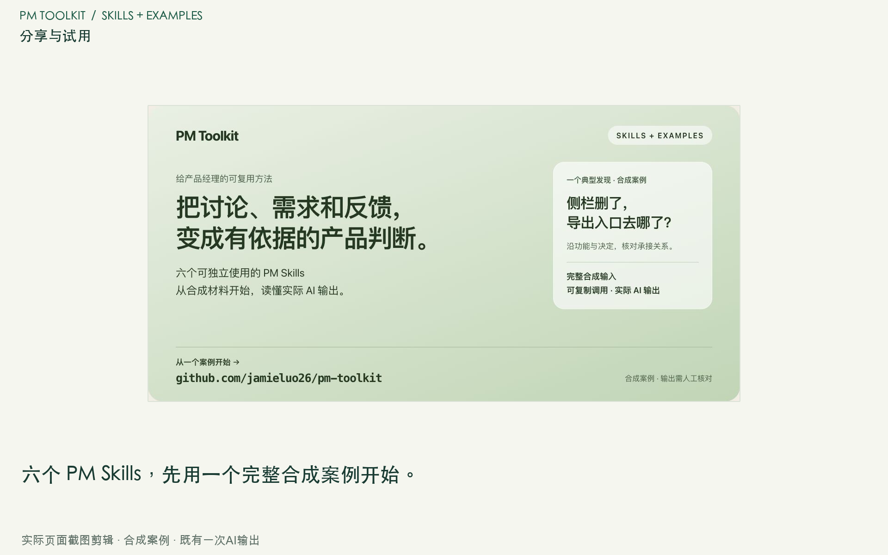

# 从一个PM问题开始

**把讨论、需求和反馈，变成有依据的产品判断。**

先看一项具体发现，再决定是否适合你的工作。这里的三个故事来自已经公开的合成案例；材料、完整调用与一次实际AI输出都可以对照。

## 选一个你熟悉的问题

| 你的问题 | 先读这篇 | 直接试用 |
|---|---|---|
| 改布局会不会漏掉原功能？ | [一句“删侧栏”，怎样避免连功能一起删？](stories/01-feedback-intent.md) | [完整反馈案例](../examples/skills/01-feedback-intent/README.md) |
| 讨论结束了，哪些事已经定了？ | [会开完了，究竟哪些事真的决定了？](stories/02-meeting-decisions.md) | [完整会议案例](../examples/skills/02-meeting-decisions/README.md) |
| 报告说通过，证据真的对应吗？ | [四条验收记录，为什么不等于全部通过？](stories/03-acceptance-evidence.md) | [完整证据案例](../examples/skills/05-acceptance-evidence/README.md) |

## 用短演示了解怎么开始

[观看或下载短演示 MP4](../assets/outreach/pm-skills-demo.mp4) · [文字步骤与字幕](demo.md)

演示由实际GitHub页面截图剪辑，展示合成案例和既有一次AI输出；没有在视频中重新运行模型，也不是真人试用记录。GitHub或你的播放器若无法内嵌播放，可直接下载MP4。

## 自己试一次

1. 打开[反馈案例的完整调用](../examples/skills/01-feedback-intent/prompt.md)，把完整文本提供给支持该长度内容的AI助手。
2. 对照[已有一次实际输出](../examples/skills/01-feedback-intent/result.md)，核对引用、未知项和你要决定的内容。模型的下一次回答可能不同。
3. 想换成自己的材料时，保留Skill全文和原记录编号，只供给你有权处理的内容。[详细使用步骤](../docs/skill-quickstart.md)

文字使用不要求先安装Python或启动工作台；这里没有配置你的AI账号、费用或原生Skill安装。

## 留三条试用反馈

[填写试用反馈](trial-feedback.md)：选了哪个案例、完成到哪一步、最希望改哪一点。AI助手与再次使用意向可选；不用提供姓名、公司或原始项目材料。

## 分享材料

[横版分享图](../assets/outreach/share-social.png) · [竖版分享图](../assets/outreach/share-portrait.png) · [待发布文案](channel-copy.md) · [素材来源](THIRD-PARTY.md)

文章和视频的解读由Codex协助整理，实际AI输出与编辑解读分开。当前未取得真人完成率、节省时间或业务收益数据。[验证边界](../docs/verification-skills-examples.md) · [六项Skill与全部案例](../examples/skills/README.md) · [回到首页](../README.md)
